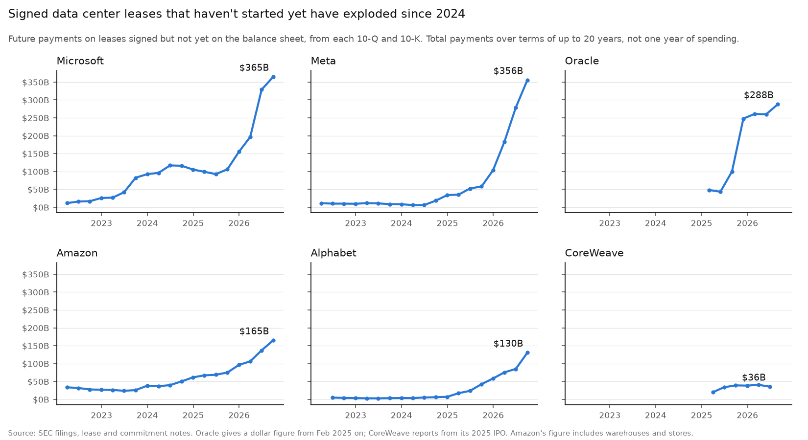
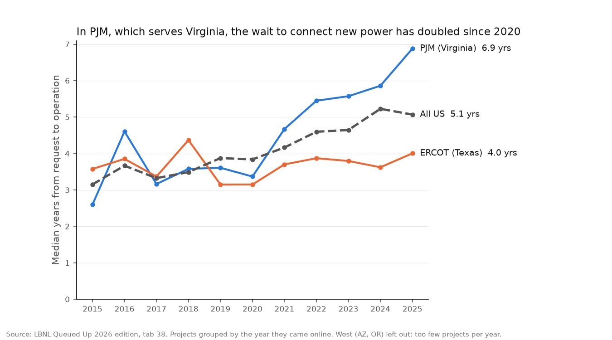
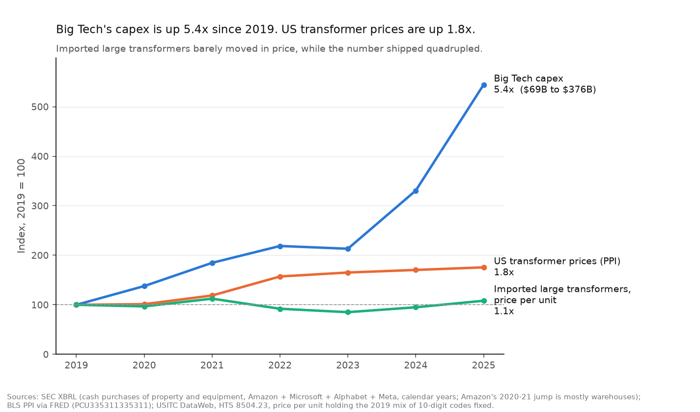
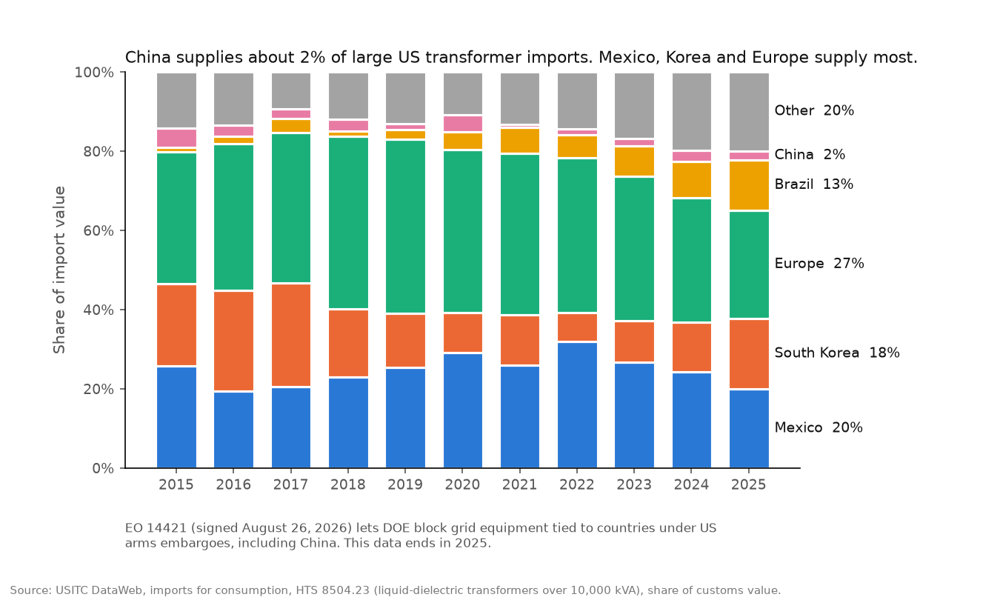

# The Grid Bottleneck: AI Demand vs the Transformer Shortage

**Finding:** The four biggest cloud companies have signed about $1 trillion of data center leases that haven't started yet, six times more than two years ago. Meanwhile, connecting a new power plant in Virginia now takes about seven years.



## The question

AI companies are spending record amounts on data centers, but some of that hardware reportedly can't be switched on. Is the buildout slowing because demand is falling, or because the grid can't keep up? And how much of the holdup is transformers, the equipment every new data center and power plant needs to connect?

## What I found

**1. Demand isn't slowing.** Amazon, Microsoft, Alphabet and Meta spent $376B on capex in 2025, 5.4 times 2019. Signed leases that haven't started yet (buildings contracted but not handed over) went from $168B in mid-2024 to $1.02 trillion in September 2026. Adding Oracle ($288B) and CoreWeave ($36B) brings it to $1.34 trillion.

**2. The grid is slow to add power where data centers are.** In PJM, which serves Northern Virginia, the median wait from requesting a grid connection to switching on a new power plant went from 3.4 years (2020) to 6.9 years (2025). Business electricity use grew 40% in Virginia since 2019, against 8% for the US.



**3. Transformers are scaling up, mostly through imports.** The number of large imported transformers (over 10,000 kVA) went from 1,208 in 2019 to 4,954 in 2025. Their price per unit barely moved (up 8%, holding the size mix fixed). US producer prices rose 76%, which matches Wood Mackenzie's estimate of 77%. Small transformers saw the real price spike: imported units cost 2.7 times what they did in 2019.



**4. Tariffs started hitting transformers in 2025.** The effective tariff on large imported units jumped from about 1.5% to 8.3%. Brazil, now 13% of supply, paid 14%.

**5. The new grid-security order targets a small supplier.** EO 14421 (August 2026) lets DOE block grid equipment tied to countries under US arms embargoes, including China. China supplies only about 2% of large transformer imports by value, so the order shouldn't do much to supply unless DOE reaches further.



## Data

| What | Source | Script |
|---|---|---|
| Transformer imports by country: value, duties, units | USITC DataWeb, imports for consumption, HTS 8504.21 to 8504.23 at 10 digits, 2015 to 2025 | `load_dataweb.py` |
| US transformer producer prices | BLS via FRED: PCU335311335311 (WPU11740999 has gaps in 2023 to 2024) | `prices.py` |
| Capex and new lease assets | SEC XBRL company facts | `capex.py`, `peers.py` |
| Signed leases not yet started | Lease notes in every 10-Q and 10-K since 2022 | `lease_notes.py` |
| Check of SEC data against filings | Cash flow statements in the same filings | `check_capex.py` |
| Grid interconnection queues | LBNL Queued Up 2026 edition (data through 2025), CC BY 4.0 | `queues.py` |
| Electricity sales and prices by state | EIA-861M monthly | `electricity.py` |
| Headline chart | All of the above | `main_chart.py` |

Notes on the Amazon Q3 2026 call are in `notes/amazon_q3_2026_call.md`. Every outside number I cite is checked in `notes/fact_check.md`.

## Method

- **Import prices** are customs value divided by units. To keep a shift toward bigger units from looking like a price rise, the fixed-mix index weights each 10-digit code by its 2019 units.
- **Effective tariff** is calculated duties divided by customs value.
- **Quarterly capex** comes from year-to-date filings: Q2 is six months minus Q1, and Q4 is the full year minus nine months. Only back-to-back periods are subtracted. Every figure was matched to its filing (116 of 119 exact; the other 3 are Meta's own later revisions).
- **Peer comparisons** use the last twelve reported months (year-to-date plus last full year minus last year's year-to-date), so different fiscal years line up.
- **Leases not yet started** come from each company's lease note, with one extraction rule per company. Every value was checked against the sentence it came from.
- **Electricity** combines commercial and industrial sales, because utilities bill data centers under either, and Oregon moved load between them in 2023.
- **Charts** are annual where sources update at different speeds, and colors are checked for colorblind readers.

## Limits

- **Signed leases are total payments over terms of up to 20 years**, not one year of spending, so don't add them to capex. Amazon's figure includes warehouses and stores.
- **Interconnection queues are power plants, not data centers.** They show how hard it is to add supply, not how long data centers wait for power.
- **Lead times come from surveys** (Wood Mackenzie). I don't have my own lead-time data.
- **Import price per unit is rough.** The largest code covers everything over 100,000 kVA.
- **Prices are nominal.**
- **I couldn't tie each 2025 tariff rate to a specific program.** Section 232 covers transformer cores and laminations since August 2025; I found no source on finished units.
- **Companies don't say power is the limit.** Amazon's Q3 2026 call named chips and memory as constraints, not power. The bottleneck case rests on the data above, not on what companies say.
- **Left out:** Nebius (no recent SEC data), private neoclouds like Lambda and Crusoe, and IREN from the lease chart (it's the landlord in its leases).

## How to run it

```bash
python3 -m venv .venv && .venv/bin/pip install -r requirements.txt
echo 'SEC_USER_AGENT="Your Name you@example.com"' > .env   # the SEC requires contact info
cd src
python load_dataweb.py     # needs the DataWeb export in data/raw (see below)
python prices.py
python suppliers_tariffs.py
python capex.py
python peers.py
python lease_notes.py      # downloads ~110 filings, a few minutes
python check_capex.py
python queues.py
python electricity.py
python main_chart.py
```

The DataWeb file has to be exported by hand: imports for consumption, HTS items, customs value + calculated duties + first unit of quantity, annual 2015 to 2025, all countries broken out, commodities `850421, 850422, 850423` broken out at 10 digits. Save it as `data/raw/dataweb_hts10.xlsx`.

## Product codes

| Code | Size | Ten-digit codes | General duty |
|---|---|---|---|
| 8504.21 | Up to 650 kVA | .0020, .0040, .0060, .0080 | Free |
| 8504.22 | 650 to 10,000 kVA | .0040, .0080 | Free |
| 8504.23 | Over 10,000 kVA | .0041 (to 59,999), .0045 (to 100,000), .0080 (over 100,000) | 1.6% |

Full table in `data/reference/hts_codes.csv`.

## Credits

Interconnection data: Lawrence Berkeley National Laboratory and GridTracker, *Queued Up* 2026 edition, CC BY 4.0. Trade data: USITC DataWeb. Prices: BLS via FRED. Electricity: EIA. Company data: SEC EDGAR.
